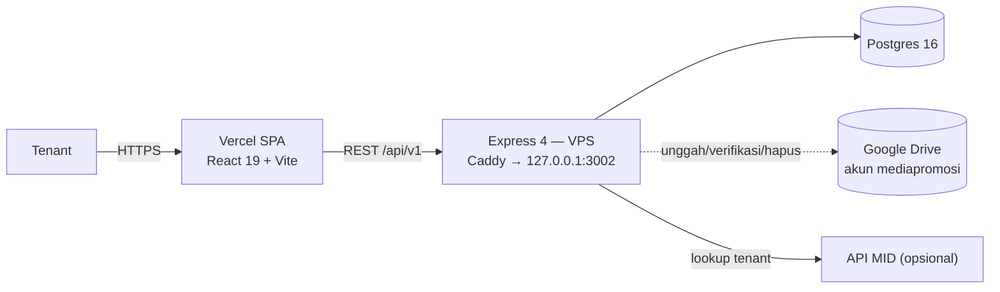

# Repository Guidelines

`medprom-metmal` — platform pengajuan materi media promosi untuk tenant
**Metropolitan Mall Bekasi**. Tenant mengirim materi, tim Tenant Relations
memverifikasi dan memprosesnya.

Aturan emas: **katalog media bersumber dari deck "MEDIA PROMOSI METROPOLITAN
MALL BEKASI 2026"** (`https://docs.google.com/presentation/d/1F7YOMu3NSEeNM115IWxd7KoNd9Ew52mTx3V2aYPwPhM/export/txt`).
Deck adalah sumber utama — jangan mengarang kebijakan yang tidak dinyatakan deck.
Bahasa UI dan pesan error: **Indonesia**.

## Project Overview

Dua sisi, satu basis kode:

- **Publik (tanpa login)** — katalog media, wizard pengajuan 3 langkah, riwayat
  per perangkat (fingerprint), **halaman status via token** (`/status/:token`),
  dan **pelacakan via nomor pengajuan** (`/lacak`, digerbangi captcha Cloudflare
  Turnstile).
- **Staf (login)** — daftar/filter pengajuan, penetapan status, pencatatan
  pemasangan, CRUD katalog, ekspor CSV, kelola akun. Role: `superadmin` >
  `admin` > `tenant_relation` (read-only).

Implementasi mengikuti PRD *Tenant Material Management* (MVP) — status
pengajuan memakai **8 tahap** PRD §8, bukan 4 nilai lama. Transisi ditegakkan di
`server/src/lib/statusFlow.js` (cermin `src/utils/statusFlow.ts`).

Dua kanal pengiriman materi, keduanya resmi:

| Kanal | Sifat | Isi |
|---|---|---|
| **Kirim tautan** | kanonis, bawaan | URL Drive/Dropbox/WeTransfer; admin verifikasi manual; tidak ada berkas di server |
| **Unggah file** | setara | Berkas ke Google Drive mall; server memverifikasi magic bytes + metadata |

Kanal unggah menyala bawaan; operator mematikannya dengan
`VITE_PROMO_UPLOAD_MODE='0'` bila instance belum punya kredensial Drive
(server membalas 503 — fail-closed, lihat `driveReady`).

Deck memuat 13 slide media; platform memecah slide social media menjadi
`sosmed-feed` + `sosmed-story` = **14 slug**, 13 aktif (`vertical-banner`
nonaktif — deck: "belum bisa digunakan, masih digunakan Mall").

## Architecture & Data Flow



**Alur submit** (`src/components/promo/PromoUploadWizard.tsx` →
`src/utils/promoApi.ts` → `server/src/routes/promo.js`):

1. Wizard validasi di klien (`goStep3()`), server **memvalidasi ulang sendiri**.
2. `enforceRateLimit` → 10/60mnt/IP; `sanitize()` tiap field; cek `PHONE_RE`,
   `DATE_RE`, `LINK_RE`, dan field wajib PRD §9.3 (+ `terms_accepted`).
3. Mode ditentukan server: `linkUrl && !driveFileId ? 'link' : 'upload'`.
4. Media harus ada **dan aktif**; lead time dihitung ulang dari `rules` di DB.
5. `device_fingerprint` **wajib** (400 bila kosong); anti-spam 5/24 jam per
   perangkat.
6. `INSERT` pengajuan + **versi 1** materi + **baris riwayat** pembuka → `201
   { success, id, submission_number, status_token, status, created_at }`.

**Halaman status** (`GET /promo/submissions/status/:token`) mengembalikan
`{ submission, history, files, installation }`; `submission` **tanpa**
fingerprint/IP (metadata internal tidak boleh bocor ke publik).

**Pelacakan via nomor** (`GET /promo/submissions/track?number=&captcha=`)
mengembalikan bentuk yang sama — pemuatan detailnya satu fungsi
(`loadSubmissionDetail`) supaya kedua jalur tidak pernah menyimpang. Nomor
pengajuan **bukan rahasia** (dibacakan ke PIC), jadi gerbangnya bukan
kerahasiaan melainkan **captcha Cloudflare Turnstile** (`lib/turnstile.js`),
diverifikasi setelah format nomor lolos dan **sebelum** DB disentuh. Verifikasi
mengikuti kontrak kanonik Cloudflare: `success` **dan** `action` cocok
(`'track'`) **dan** `hostname` ada di `TURNSTILE_HOSTNAMES`. Gangguan Siteverify
→ `503` fail-closed. Tanpa `TURNSTILE_SECRET_KEY` verifikasi **dilewati**
(peringatan boot); secret terisi tanpa allowlist hostname → **ditolak**
fail-closed. Lihat pitfall #15.

**Revisi** (`POST /promo/submissions/:id/revision`) hanya saat status
`perlu_revisi`; kepemilikan ditegakkan lewat fingerprint; versi lama **tidak
dihapus**, status kembali `menunggu_review`.

**Batas kepercayaan** — untuk mode unggah, server **membuang semua klaim klien**:
nama/MIME/ukuran diambil dari metadata Drive (`getDriveFile`), magic bytes
diverifikasi **sebelum** byte apa pun ditulis ke Drive. Satu objek Drive = satu
pengajuan (guard eksplisit + unique partial index `idx_ps_drive_file`).

**Envelope respons**: GET → `{ success, data }`; POST → flat `{ success, id }`;
validasi → `400 { success: false, errors: [] }`; paginasi → `+ total/page/per_page`.
Pengecualian yang disengaja: `/auth/me` → `{ success, user }` tanpa `data`
(dibaca `apiGetRaw`), dan `/admin/export` → CSV BOM.

## Key Directories

| Path | Isi |
|---|---|
| `src/components/promo/` | Landing katalog, wizard, riwayat, **halaman status token**, **pelacakan nomor**, `SubmissionDetail` (dipakai kedua jalur), pemilih tenant |
| `src/components/admin/` | Login + dashboard staf (`AdminDashboardPage.tsx` = 3 tab) |
| `src/components/ui/` | Komponen bersama: `Sheet`, **widget captcha Turnstile** |
| `src/utils/` | Klien API (`promoApi`, `adminApi`), `leadTime`, **`statusFlow`**, `whatsapp`, `fingerprint` |
| `src/lib/rest.ts` | Klien REST — satu-satunya tempat `VITE_API_URL` dibaca |
| `src/hooks/` | `useAuth` (sesi), `usePermission` (kosmetik saja) |
| `src/constants/promo.ts` | Label 8 status, batas 50MB, `isUploadModeEnabled()` |
| `server/src/routes/` | `promo` (publik), `admin` (staf), `auth` |
| `server/src/` | `index.js` (entry), `drive.js`, `auth.js`, `db.js`, `lib/` |
| `server/src/lib/` | `leadTime`, **`statusFlow`** (alur status), **`identifiers`** (nomor + token), **`turnstile`** (captcha), `rateLimit` |
| `server/scripts/` | `seed-media-types.mjs` (katalog deck), `create-admin.mjs` |
| `scripts/` | `db-migrate.mjs`, `verify-*.mjs` (Playwright) |
| `__tests__/api/` | Test route server |
| `deploy/vps/` | `docker-compose.yml`, `backup.sh`, `README-DEPLOY.md` |
| `docs/` | Rencana + log eksekusi (`PLAN_YYYY-MM-DD_HH-mm.md`) |

## Development Commands

```bash
npm ci
cp .env.example .env          # isi DATABASE_URL, JWT_SECRET, GOOGLE_*
npm run db:migrate            # skema (idempotent)
npm run db:seed               # katalog: sinkron accepted_formats + rules
npm run dev:api               # API  → http://localhost:3001
npm run dev                   # FE   → http://localhost:5173

npm run build                 # tsc && vite build
npm test                      # vitest run
npx vitest run __tests__/api/lead-time.test.js   # satu file
node --check server/src/routes/promo.js          # file server yang diubah
```

**Gate verifikasi sebelum commit** (jangan dilewati):
`npm run build` hijau + `npx vitest run` hijau + `node --check` file server yang
diubah + scan secret (`git diff --cached --name-only` tidak memuat `.env`,
`client_secret*`, `*-token.json`).

Verifikasi produksi (Playwright, butuh `VERIFY_PASSWORD` dan
`npx playwright install chromium`):

```bash
node scripts/verify-e2e.mjs            # katalog → form → dashboard → riwayat
node scripts/verify-admin-flow.mjs     # status staf → terlihat tenant
```

## Code Conventions & Common Patterns

- **ESM di mana-mana.** Root `package.json` `"type": "module"` berlaku untuk
  server, scripts, dan test. Tidak ada CJS (`require`/`module.exports`). Server
  dijalankan langsung Node, tanpa build step.
- **Bahasa Indonesia** untuk UI, pesan error, komentar, dan deskripsi test.
- **Diff minimal dan bedah** — ubah baris yang perlu saja, jangan format ulang
  file. Ikuti pola file yang ada; konvensi kedua dilarang.
- **Tanpa dependensi baru** tanpa persetujuan (multipart di-parse manual, tanpa
  multer/SDK; Drive via `fetch`).
- **Input selalu `sanitize(val, maxLen)`** (strip NUL, trim, potong) sebelum
  dipakai — pola yang sama ada di `promo.js` dan `admin.js`.
- **Envelope + error Indonesia verbatim ke UI.** Handler async selalu
  `try { … } catch (err) { return next(err); }`; error handler terakhir
  menerjemahkan `DB_UNAVAILABLE` → 503.
- **Fail-closed**: konfigurasi hilang (MID key, Drive) → tolak bersih, jangan
  bypass.
- **State management: hanya `useState` lokal + custom hook.** Tidak ada Redux,
  React Query, maupun Context Provider. Persistensi lintas-render:
  `sessionStorage` (draf wizard) dan `localStorage` (fingerprint).
- **Warna via token** (`var(--brand-*)`, `src/styles/theme.css`), bukan hex.
  Kontras teks kecil AA: pakai `*-600/700`, bukan `*-500`.
- **Role: otorisasi nyata ada di server.** `usePermission` hanya menyembunyikan
  tombol; `requireRole` yang menentukan. Role dibaca ulang dari DB tiap request,
  bukan dari klaim JWT.

**Cermin FE↔BE yang disengaja** (proyek ini belum punya paket bersama — ubah
**berpasangan**, jangan salah satu):

| Konsep | FE | BE |
|---|---|---|
| Lead time + email kanal | `src/utils/leadTime.ts` | `server/src/lib/leadTime.js` |
| Alur status + transisi | `src/utils/statusFlow.ts` | `server/src/lib/statusFlow.js` |
| Batas 50MB | `src/constants/promo.ts` | `server/src/drive.js` |
| MIME diterima | `acceptedMimes()` + `MIME_LABELS` | `ALLOWED_MIME` |
| Regex telepon/tautan | inline di wizard | `PHONE_RE`, `LINK_RE` |

Pasangan lead time dikunci `__tests__/api/lead-time.test.js` dan pasangan alur
status dikunci `__tests__/api/status-flow.test.js` (keduanya mengimpor kedua
modul, assert kesamaan output) — menyimpang = test gagal. Urutan migrasi status
di `server/schema.sql` dikunci `__tests__/api/schema-migration.test.js`.

**Aturan lead time diturunkan dengan mem-parse teks `rules`, bukan `category`.**
Ketentuan deck tidak seragam: `boom-gate` outdoor tetapi **3 hari kerja**;
`spanduk` 2 hari kalender; media sosial tanpa lead time. Hari kerja = minus
Sabtu/Minggu saja (libur nasional belum ada tabelnya).

**Kanal unggah**: `isUploadModeEnabled()` mengembalikan `true` kecuali
`VITE_PROMO_UPLOAD_MODE === '0'` (opt-out untuk instance tanpa kredensial Drive;
server membalas 503 lewat `driveReady`). Flag hanya menggerbangi perenderan UI —
kode unggah tetap ikut ter-bundle (mode = state React). Jangan klaim tree-shaking.

## Important Files

| File | Kenapa penting |
|---|---|
| `src/main.tsx`, `src/App.tsx` | Entry React + tabel rute (`/`, `/ajukan`, `/riwayat`, `/lacak`, `/status/:token`, `/login`, `/admin`) |
| `src/lib/rest.ts` | Klien REST; `API_V1_BASE` = `VITE_API_URL` + `/api/v1`; `ApiError` |
| `src/utils/promoApi.ts` | `errorsFromApiError`/`mapSubmitErrors` memetakan `errors[]` server ke field form; `fetchStatusByToken`, `fetchStatusByNumber` (nomor + token captcha), `submitRevision` |
| `src/utils/statusFlow.ts` | Cermin alur status + transisi; dipakai dashboard untuk menyaring status yang sah |
| `server/src/index.js` | Middleware (CORS whitelist → json 2mb → cookie), mount router, `/healthz`, 404 + error JSON |
| `server/src/routes/promo.js` | Endpoint publik; validasi, lead time, nomor/token, halaman status, revisi |
| `server/src/routes/admin.js` | Seluruh API staf (paginasi, pencarian, ringkasan, transisi status, pemasangan, CSV, CRUD) |
| `server/src/auth.js` | JWT (jose HS256) + cookie `sb-access-token`; `requireRole`, `logActivity` |
| `server/src/drive.js` | Drive REST v3: magic bytes, upload, metadata, delete; `driveReady` (fail-closed 503) |
| `server/src/lib/statusFlow.js` | Sumber kebenaran transisi status (8 nilai PRD) |
| `server/src/lib/identifiers.js` | Nomor pengajuan `MP-YYMMDD-XXXXXX` + token status acak |
| `server/src/lib/turnstile.js` | Verifikasi captcha Cloudflare Turnstile (Siteverify); `turnstileConfigured()` |
| `server/src/lib/leadTime.js` | Cermin aturan lead time |
| `server/schema.sql` | Sumber migrasi (7 tabel + index); remap status lama → 8 nilai PRD |
| `server/scripts/seed-media-types.mjs` | Katalog deck — `ON CONFLICT` menyinkron SELURUH kolom yang dikelola seed (termasuk `price_note`, `location_note`, `image_path`) |
| `vitest.config.ts` | Konfigurasi test (terpisah dari `vite.config.ts`) |
| `vercel.json` | Rewrite SPA `/(.*)` → `/index.html` |

## Runtime/Tooling Preferences

- **Runtime: Node 20+** (produksi `node:20-alpine`; `vitest` yang mengikat).
  Pengecualian: `scripts/drive-auth.mjs` memakai `Promise.withResolvers` yang
  butuh **Node 22+**. Tidak ada field `engines`.
- **Package manager: npm** (`package-lock.json`, lockfileVersion 3). Tidak ada
  pnpm/yarn/bun.
- **Tidak ada lint/format tooling sama sekali** — tidak ada ESLint, Prettier,
  Biome, EditorConfig, husky, maupun CI (`.github/` tidak ada). Tiga komentar
  `// eslint-disable-next-line` di sumber bersifat inert.
- **TypeScript hanya mencakup `src/`** (minus test). `server/**`, `scripts/**`,
  dan `__tests__/**` **tidak pernah** di-type-check — `node --check` hanya
  memeriksa sintaks.
- **`tsconfig.node.json` tidak dapat di-build** (`tsc -p tsconfig.node.json` →
  TS2307 karena `moduleResolution: "Node"` tidak bisa me-resolve
  `@tailwindcss/vite`). `npm run build` memakai `tsc` biasa, jadi file itu tidak
  pernah ter-type-check.
- **Alias `@/*` dideklarasikan 3 tempat tetapi dipakai 0 kali** — impor selalu
  relatif.
- **Env FE**: hanya variabel ber-prefix `VITE_` yang sampai ke browser. Nilai
  di-inline **saat build** — mengubah `VITE_API_URL` perlu build + deploy ulang.
  `VITE_API_URL` = base URL **tanpa** suffix `/api/v1` (klien yang menambahkannya).
  Pasangan captcha: `VITE_TURNSTILE_SITE_KEY` (publik) ↔ `TURNSTILE_SECRET_KEY`
  (server, tidak pernah ke browser) + `TURNSTILE_HOSTNAMES` (allowlist hostname).
- **Urutan deploy wajib**: API + skema dulu, frontend terakhir. Frontend baru di
  atas API lama = tombol yang pasti gagal.

## Testing & QA

- **Runner**: Vitest 4 (`npx vitest run`), environment **jsdom** global, satu
  setup file `src/test/setup.ts` (`import '@testing-library/jest-dom'`).
  Konfigurasi di `vitest.config.ts`; include `src/**/*.test.ts(x)` dan
  `__tests__/**/*.test.{js,ts}`.
- **32 file / 274 test, semuanya hijau.** Tidak ada test yang di-skip.
- **Gaya**: `describe`/`it` (bukan `test`), deskripsi **Indonesia** dengan pola
  `<kondisi> → <harapan>`. Nama file mengikuti modul yang diuji.
- **Lokasi**: test komponen co-located (`__tests__/` di samping komponen), test
  route server di `__tests__/api/`, test util di `src/utils/__tests__/`.
- **Query komponen**: utamakan `getByRole`/`getByLabelText`; jangan `data-testid`.
  Gunakan `await screen.findBy…` untuk kemunculan.
- **Mock**: `vi.mock` sebelum import modul yang diuji; `db`/`drive`/`rateLimit`
  diganti `vi.fn()`; handler Express dipanggil langsung lewat `router.stack`
  (tanpa supertest); `vi.stubEnv` untuk flag; `vi.resetModules()` bila perlu
  menjalankan ulang modul ESM (seed).
- **Test memakai data deck asli** (`rules` verbatim dari seed), bukan fixture
  karangan — khususnya `leadTime.test.ts` dan `__tests__/api/lead-time.test.js`.
- **Test baru hanya untuk kontrak yang rapuh**; jangan mengunci implementasi
  atau plumbing. Setiap komponen baru wajib mount test.
- **Celah yang diketahui**: `routes/auth.js` (rute `/auth/*`), `db.js`,
  endpoint `/drive/upload`, dan `src/utils/fingerprint.ts` **belum ada test**.
  `auth.js` (middleware `requireRole`/`authenticate`) dan `lib/rateLimit.js`
  kini diuji nyata tanpa mock (`__tests__/api/authz.test.js`,
  `rate-limit.test.js`); registrasi rute diuji `src/__tests__/App.test.tsx`.
  `@vitest/coverage-v8` terpasang tetapi tidak
  dikonfigurasi (tidak ada threshold/script).

## Pitfalls — jangan mengulang kesalahan ini

1. **rsync menghapus backup DB.** `backup.sh` menulis ke
   `/opt/medprom/backups`, yaitu **di dalam** tujuan rsync `/opt/medprom/`, dan
   source tidak punya `backups/`. Dengan `--delete`, **setiap rilis menghapus
   seluruh backup**. Sudah diperbaiki: kedua perintah rsync di
   `deploy/vps/README-DEPLOY.md` kini memuat `--exclude 'backups/'`. Alternatif
   yang lebih tahan salah: deploy tanpa `--delete` (merge) — itu yang dipakai
   saat rilis 1.3.0.
2. **`--exclude .env*` juga membuang `.env.example`** — langkah berikutnya
   (`cp .env.example .env`) gagal di VPS baru. Kecualikan `.env` spesifik, bukan
   globnya. Perhatikan: pola itu juga yang **melindungi** `deploy/vps/.env` dari
   `--delete`; memperbaikinya harus bersamaan.
3. **Server TIDAK menegakkan format per media.** `ALLOWED_MIME` di `drive.js`
   adalah satu set global (JPEG/PNG/PDF/MP4); `accepted_formats` dibaca tetapi
   tidak pernah dibandingkan dengan MIME unggahan. Hanya wizard yang membatasi
   per media. Klaim README bahwa server ikut menegakkan per media **tidak
   benar**.
4. **`grep -c` pada JSON menghitung baris, bukan kemunculan.** Respons
   `/promo/media-types` satu baris, jadi verifikasi katalog harus
   `grep -o '…' | wc -l`.
5. **`users.role DEFAULT 'viewer'`** melanggar CHECK-nya sendiri (nilai itu bukan
   bagian daftar role). Sudah diperbaiki: default kini `'tenant_relation'`, dan
   `schema.sql` menyetel ulang default untuk DB yang sudah jalan.
6. **Urutan migrasi status WAJIB: lepas CHECK lama → remap → pasang CHECK baru.**
   CHECK lama (`pending`/`approved`/`rejected`/`installed`) menolak nilai PRD,
   jadi meremap status sebelum melepasnya menggagalkan `db:migrate` di **setiap
   DB yang sudah jalan** — sementara DB baru tetap hijau, sehingga bug ini hanya
   muncul di produksi. Jangan pula mengandalkan nama constraint lama
   (`promo_submissions_status_check`); nama itu bergantung versi skema — cari
   lewat `pg_get_constraintdef`. Dikunci
   `__tests__/api/schema-migration.test.js`.
7. **`clientIp()` memakai `x-real-ip` tanpa verifikasi proxy** (tidak ada
   `app.set('trust proxy')`). Mitigasi: `deploy/vps/Caddyfile` (berversi) wajib
   memuat `header_up X-Real-IP {remote_host}` sehingga edge menimpa header
   kiriman klien. Bila instance di-proxy tanpa aturan itu, rate limit per-IP
   masih bisa dilewati dengan memutar header.
8. ~~Rate limit fingerprint bersyarat (`if (fingerprint)`)~~ — **sudah
   diperbaiki**: `device_fingerprint` kini **wajib** di `POST /promo/submit`
   (400 bila kosong), sama dengan revisi, sehingga batas 5/24 jam tidak bisa
   dilewati dengan mengosongkan field. `GET /promo/submissions/mine` (responsnya
   memuat `status_token` rahasia) juga kini dibatasi 60/15 mnt per IP.
9. **`server/src/drive.js` menampung seluruh body di memori** sebelum dikirim ke
   Drive (bukan hanya "kepala file" seperti klaim header modul) — plafon memori
   VPS perlu diperhitungkan.
10. **Kode & skema harus naik BERSAMAAN — jangan migrasi dulu, deploy kode
    kemudian.** CHECK status baru (`menunggu_review` dst.) menolak nilai lama
    yang masih ditulis kode versi sebelumnya, sehingga di antara migrasi dan
    restart API **setiap pengajuan baru gagal `400`** — padahal `/healthz` tetap
    `ok` karena tidak menyentuh DB, jadi container tampak sehat. Terbukti saat
    rilis 1.3.0: `INSERT ... status='installed'` → `violates check constraint`.
    Urutan aman: kirim kode → `docker compose stop api` → terapkan skema →
    `docker compose up -d api`. Container lama boleh tetap jalan saat kode
    disalin (mount read-only, kode sudah termuat di memori).
11. **`deploy/vps/docker-compose.yml` tidak lagi memuat `R2_*`** (penyimpanan
    pindah ke Google Drive sejak 1.1.0), sedangkan `.env` di VPS masih berisi
    `R2_*`. Compose mengabaikan variabel yang tidak dipakai, jadi ini tidak
    menggagalkan apa pun — tetapi `R2_*` di `.env` sudah mati dan aman dihapus.
    Sebaliknya `GOOGLE_*` sengaja opsional (`:-`) karena kanal unggah
    fail-closed; instance tanpa kredensial Drive tetap boot dengan kanal tautan.
12. **Line ending: repo dipaksa LF lewat `.gitattributes`.** Mesin dev memakai
    `core.autocrlf=true` (default Git for Windows), jadi **jangan hapus
    `.gitattributes`**. Deploy mengirim *working tree* apa adanya lewat rsync ke
    VPS Linux, bukan hasil `git archive` — skrip shell ber-CRLF
    (`deploy/vps/backup.sh`, dipanggil cron) gagal dieksekusi dengan
    `bad interpreter`/`\r` liar, dan berkas ber-CRLF yang disunting ulang
    menghasilkan diff se-berkas (pernah terjadi: AGENTS.md tampak berubah 427
    baris padahal suntingannya kecil). Setiap berkas baru wajib LF.
13. **Halaman `/login` menampilkan kredensial staf selama pengembangan.** Panel
    di `AdminLoginPage` mencetak email ketiga akun + password `admin123` ke
    siapa pun yang membuka `/login`, dan ketiga akun produksi memang memakai
    password itu. Digerbangi `VITE_PROMO_SHOW_DEV_LOGIN` (opt-out, pola sama
    dengan `VITE_PROMO_UPLOAD_MODE`) yang sumbernya
    `src/constants/devCredentials.ts`. **Sebelum dipakai publik**: set flag ke
    `'0'`, build + deploy ulang (nilai `VITE_*` di-inline saat build, bukan
    dibaca runtime — mengubah env Vercel saja tidak cukup tanpa redeploy), lalu
    reset password akun nyata. Perlu diingat flag hanya menggerbangi
    perenderan, jadi kredensialnya tetap ada di bundle.
14. **Klaim di komentar/docs harus cocok dengan kode.** Docs basi wajib
    diperbaiki saat menyentuh area itu.
15. **Captcha Turnstile: dua env, dua mode gagal yang berbeda.** `TURNSTILE_SECRET_KEY`
    kosong → verifikasi **dilewati** (hanya peringatan log boot; instance lama
    tetap jalan). Secret terisi tetapi `TURNSTILE_HOSTNAMES` kosong → verifikasi
    **ditolak** `503` fail-closed, karena cek `hostname` tidak bisa dijalankan.
    Isi bersamaan: secret di `.env` server **dan** `VITE_TURNSTILE_SITE_KEY` di
    env build FE (nilai `VITE_*` di-inline saat build — mengubah env Vercel saja
    tidak cukup tanpa redeploy). Allowlist hostname produksi **jangan** memuat
    `localhost`/`127.0.0.1`. Bila Siteverify tak terjangkau saat verifikasi
    berjalan, endpoint membalas `503` (fail-closed), bukan meloloskan permintaan.
16. **Verifikasi captcha tidak berhenti di `success`.** Token Turnstile yang sah
    dari widget lain tetap harus ditolak: `lib/turnstile.js` mencocokkan `action`
    (widget `/lacak` memasang `action="track"`) dan `hostname` terhadap
    allowlist. Jangan hapus cek ini — tanpa `action`, token bisa dipakai ulang di
    permukaan lain; tanpa `hostname`, token dari situs mana pun yang memakai
    sitekey sama ikut lolos.
17. **`110200` = hostname belum terdaftar di dashboard Cloudflare.** Widget
    terpasang di DOM (ada input `cf-turnstile-response`) tetapi Cloudflare
    membalas `400` dan token tidak pernah terbit — gejalanya tombol submit
    terkunci selamanya, tanpa pesan error di UI. Ini murni konfigurasi
    dashboard (*Turnstile → widget → Settings → Hostname Management*), bukan
    bug kode. Daftarkan domain produksi **dan** `localhost`/`127.0.0.1` untuk
    uji lokal. Domain produksi proyek ini: `medprom-metmal.vercel.app`.

## Commit & Rilis

- Pesan commit konvensional **Indonesia**: `feat|fix|docs|ops|chore|security: ...`
  (imperatif, area jelas).
- `CHANGELOG.md` mengikuti Keep a Changelog + SemVer; rilis fitur → bump
  `package.json` + entri changelog.
- Jalankan `npm run db:seed` setelah update yang mengubah `rules`/format —
  seed hanya menulis kolom yang berubah (`IS DISTINCT FROM`), jadi aman diulang.

### Dokumentasi rencana & log eksekusi

- **Wajib**: setiap rencana atau audit eksekusi disimpan di `docs/` dengan nama
  **`PLAN_YYYY-MM-DD_HH-mm.md`** (contoh: `docs/PLAN_2026-09-16_12-04.md`).
  Jam memakai waktu lokal WIB. Satu berkas memuat rencana **dan** log hasilnya —
  jangan buat berkas terpisah untuk keduanya.
- Isi minimal: tujuan, keputusan yang disepakati, rencana langkah, log eksekusi,
  perbaikan selama pengerjaan, risiko + cara rollback, dan sisa pekerjaan.
- Tulis bagian rencana sebelum mulai; perbarui bagian log setelah tiap langkah
  diverifikasi. Jangan tinggalkan dokumen yang mengklaim sesuatu yang belum
  terjadi.

### Changelog wajib

- **Wajib**: setiap penambahan, perubahan, refactoring, atau perbaikan bug
  dicatat di `CHANGELOG.md` bagian **`[Unreleased]`**, dikelompokkan per
  kategori. Judul yang sudah dipakai repo ini: **`### Ditambahkan`** (Added),
  **`### Diubah`** (Changed), **`### Diperbaiki`** (Fixed), ditambah
  **`### Keamanan`** untuk hal berbau keamanan. Untuk refactoring dan
  penghapusan, pakai **`### Dirapikan`** (Refactored) dan **`### Dihapus`**
  (Removed) — belum ada di riwayat, tetapi ikuti pola penamaan yang sama.
  Jangan pakai judul bahasa Inggris.
- Berlaku untuk **agen dan sub-agen** yang mengubah kode: tulis entri changelog
  sebagai bagian dari pekerjaan itu, bukan sebagai langkah terpisah di akhir.
- Saat rilis: pindahkan isi `[Unreleased]` ke heading versi bertanggal, lalu
  kosongkan `[Unreleased]` kembali.
- Tulis dampaknya bagi pemakai/operator (perilaku yang berubah, migrasi yang
  diperlukan, env baru) — bukan sekadar daftar berkas yang disentuh.

## Deploy

Panduan penuh: `deploy/vps/README-DEPLOY.md`. Ringkasnya: rsync repo (**wajib**
mengecualikan kredensial — `.gitignore` tidak berlaku untuk rsync) →
`cp .env.example .env` → `docker compose up -d` → `db-migrate` + `seed` (dari
container api) → Caddy subdomain → smoke `/healthz` → Vercel (`VITE_API_URL`) →
isi `CORS_ORIGIN` → restart api.

- Backup DB: cron `30 3 * * *` WIB, `pg_dump` gzip, retensi 14 file.
- Log: `docker compose logs -f api`.
- Sweep Drive yatim: `node scripts/drive-sweep.mjs [--apply]` (dari host yang
  punya `GOOGLE_*` + `DATABASE_URL`).
- `scripts/drive-auth.mjs` dan `scripts/drive-sweep.mjs` **git-ignore** — tidak
  ada di clone baru, meskipun disebut di dokumentasi.

### Secrets & kredensial Drive

- Env: `GOOGLE_CLIENT_ID`, `GOOGLE_CLIENT_SECRET`, `GOOGLE_REFRESH_TOKEN`,
  opsional `DRIVE_ROOT_FOLDER_ID`. Hanya template (`*.example`) yang ikut git.
- Captcha: `TURNSTILE_SECRET_KEY` di `.env` server (dan
  `VITE_TURNSTILE_SITE_KEY` di env build FE). Tanpa secret key, verifikasi
  `/lacak` dilewati — lihat pitfall #15.
- `.env`, `client_secret*.json`, `*-token.json` git-ignore — **tidak pernah**
  commit. `deploy/vps/.env` tidak ada di repo; salin manual 3 var `GOOGLE_*`.
- Produksi token (butuh Node 22+, sekali saja dari mesin lokal):
  `GOOGLE_CLIENT_ID=... GOOGLE_CLIENT_SECRET=... node scripts/drive-auth.mjs`,
  buka URL, login akun `mediapromosi.metmalbekasi@gmail.com`, izinkan. Syarat
  GCP: akun itu terdaftar di **OAuth consent screen → Test users** (status
  Testing cukup untuk scope `drive.file`) + Drive API enabled. Redirect URI
  harus persis `http://localhost:3715/callback`.
- Unggahan diberi izin `anyone: reader` — siapa pun yang punya URL dapat
  mengunduh materi tenant. Ini paritas dengan URL publik R2 sebelumnya, tetapi
  perlu disadari sebagai permukaan disklosur.

Lisensi: proprietary, internal Metropolitan Mall Bekasi.
