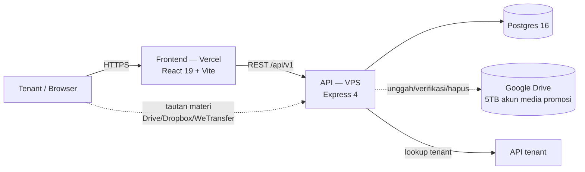

# Medprom Metmal — Platform Media Promosi Tenant

Platform pengajuan materi media promosi untuk tenant **Metropolitan Mall
Bekasi**. Tenant mengisi form pengajuan materi promosi, tim **Tenant
Relations** mengecek dan memproses materi promosinya.

Katalog media beserta ukuran, material, harga, dan ketentuannya bersumber dari
deck *"MEDIA PROMOSI METROPOLITAN MALL BEKASI 2026"* — 13 slide media. Platform
memecah satu slide social media ("Instagram, Fanpage, dan Tiktok") menjadi dua
entri (feed dan story), sehingga totalnya 14 jenis media; 13 aktif, dan
**Vertical Banner** belum tersedia (masih digunakan Mall).

## Kemampuan

### Sisi tenant — publik, tanpa login

- Katalog media per kategori Outdoor, Indoor, dan Media Sosial, memuat ukuran,
  material, harga, serta ketentuan pemasangan tiap media.
- Form pengajuan tiga tahap: pilih media, isi data tenant/PIC/materi, kirim
  materi.
- **Form media promosi cetak** (`/ajukan-cetak`) untuk spanduk, big banner, dan
  umbul-umbul: tanggal pengajuan, nama pemohon, nama tenant **atau nama
  non-tenant**, telepon, periode pemasangan, tanggal pemasangan, dan lokasi
  pemasangan. Pemohon **tenant maupun non-tenant** dapat mengajukan, dan
  **beberapa media dapat dipilih sekaligus** dalam satu kirim. Form ini tidak
  meminta berkas materi (materi menyusul lewat alur revisi). Harga dihitung
  server dengan **PPN 11%** di atas tarif deck, dan minimal sewa 7 hari
  ditegakkan. Setiap kirim menghasilkan satu **nomor batch**
  (`MPB-YYMMDD-XXXXXX`) yang halaman statusnya menampilkan seluruh media
  sekaligus (`/batch/:token`).
- Nama tenant dipilih dari API tenant. Bila API tidak tersedia, form beralih ke
  isian nama manual.
- Dua cara mengirim materi:
  - **Kirim tautan** — Google Drive, Dropbox, atau WeTransfer untuk materi
    berukuran besar maupun folder berisi banyak file. Tidak ada file yang
    tersimpan di server. Materi diverifikasi manual oleh tim Tenant Relations.
  - **Unggah file** — file dikirim langsung dari browser, diverifikasi server
    (signature byte + metadata), lalu disimpan di Google Drive mall. Batas 50MB.
- Ketentuan lead time tiap media ditegakkan: tanggal pemasangan ditolak bila
  kurang dari ketentuan deck ("2 hari sebelum pemasangan" atau "3 hari kerja
  sebelum pemasangan"), baik di form maupun di server.
- **Nomor pengajuan** (`MP-YYMMDD-XXXXXX`) dan **tautan status ber-token** setelah
  pengajuan terkirim. Halaman status menampilkan status terkini, catatan tim,
  riwayat perubahan status, riwayat versi materi, dan informasi pemasangan —
  tanpa perlu akun.
- **Lacak dengan nomor pengajuan** — halaman `/lacak` menerima nomor pengajuan
  dan menampilkan halaman status yang sama, untuk tenant yang kehilangan tautan.
  Dijaga **captcha Cloudflare Turnstile** agar nomor tidak dipanen otomatis.
- **Revisi materi**: ketika status materi **Perlu Revisi**, tenant dapat
  mengirim ulang materi (tautan atau file) dari halaman status. Versi lama tetap
  tersimpan untuk tim.
- Halaman Riwayat per perangkat menampilkan status dan catatan tim.

### Sisi staf — perlu login

- Ringkasan jumlah pengajuan per status (klik untuk memfilter), pencarian nomor
  pengajuan/tenant/judul materi, filter status/media/tenant/rentang tanggal, dan
  paginasi.
- Detail pengajuan: informasi tenant/PIC/campaign, materi, riwayat versi file,
  riwayat status, dan informasi pemasangan.
- Penetapan status mengikuti alur 8 tahap PRD: Menunggu Review, Perlu Revisi,
  Disetujui, Ditolak, Siap Dipasang, Sudah Dipasang, Selesai. Komentar wajib saat
  meminta revisi, alasan wajib saat menolak.
- Pencatatan pemasangan (media/lokasi, tanggal, catatan, bukti tayang) — hanya
  untuk materi yang sudah disetujui. Bukti tayang dapat berupa **tautan** atau
  **unggahan berkas** (JPEG/PNG/PDF/MP4, maks 50MB) ke Google Drive mall.
- **Pengingat periode berakhir**: materi ber-pajak yang sudah dipasang dan
  periodenya mendekat/lewat ditampilkan di dashboard (query turunan, tanpa
  email/cron), dengan tombol "Ingatkan via WhatsApp".
- Pengelolaan katalog media: harga, ukuran, ketentuan, kanal
  (Cetak/Digital), dan status aktif.
- Ekspor CSV siap dibuka di Excel.
- Pengelolaan akun staf.

### Hak akses

| Role | Lihat pengajuan | Proses & katalog | Kelola akun |
|---|---|---|---|
| `superadmin` | Ya | Ya | Ya |
| `admin` | Ya | Ya | Tidak |
| `tenant_relation` | Ya | Tidak | Tidak |

## Arsitektur



- Frontend berjalan di Vercel sebagai SPA; seluruh path di-rewrite ke
  `index.html`.
- API dan Postgres berjalan di VPS melalui Docker Compose, diproksi Caddy ke
  `127.0.0.1:3002`.
- **Kirim tautan** adalah kanal bawaan: tenant menyimpan materinya di
  penyimpanan sendiri dan mengirim URL; tim Tenant Relations memverifikasi
  manual. Tidak ada berkas tenant yang masuk ke storage mall pada jalur ini.
- **Unggah berkas** adalah kanal setara untuk tenant yang ingin mengirim berkas
  langsung; penyimpanan Drive akun `mediapromosi.metmalbekasi@gmail.com`
  (Google One 5TB) dipakai. Unggahan diverifikasi di server (signature byte +
  ukuran) SEBELUM ditulis ke Drive sehingga file tidak valid tidak pernah
  memenuhi storage.
- Sesi staf memakai JWT pada cookie lintas origin (`SameSite=None; Secure`).

### Validasi pengajuan

Untuk mode unggah, server memeriksa

1. rate limit 10 pengajuan per jam per IP
2. field wajib PRD (+ telepon, format tanggal, media aktif, persetujuan ketentuan)
3. drive_file_id benar-benar ada di Drive (milik akun app, bukan tenant lain —
   scope OAuth `drive.file`)
4. metadata Drive: ukuran ≤ 50MB
5. file belum dipakai pengajuan lain (unique constraint DB)
6. rate limit 5 pengajuan per perangkat dalam 24 jam (fingerprint wajib)

Mode tautan hanya menerima URL berskema `http` atau `https`.

Kedua mode memeriksa **lead time** setelah media diketahui: tanggal pemasangan
harus menyisakan cukup waktu menurut ketentuan media tersebut. Aturan diturunkan
dari teks `rules` katalog — bukan dari kategori — karena ketentuannya tidak
seragam (boom gate tergolong outdoor tetapi memakai hari kerja). Pengajuan yang
masuk lebih lambat dari lead time ditolak `400` dengan pesan yang menyebut
jumlah hari; dashboard staf menandainya sebagai berisiko.

Perhitungan hari kerja hanya mengecualikan Sabtu dan Minggu — tabel hari libur
nasional belum tersedia, sehingga tanggal pasang yang jatuh pada hari libur
nasional belum ditolak.

## Alur status pengajuan

Status mengikuti PRD dan ditegakkan di server (bukan hanya di UI):

```
Menunggu Review ──┬─→ Perlu Revisi ──→ Menunggu Review   (revisi materi)
                  ├─→ Disetujui ──┬─→ Siap Dipasang ──→ Sudah Dipasang ──→ Selesai
                  │               └─→ Sudah Dipasang
                  └─→ Ditolak  (final)
```

- Transisi di luar alur ini ditolak `400` — termasuk lompatan seperti
  Menunggu Review → Sudah Dipasang.
- **Komentar wajib** saat meminta revisi; **alasan wajib** saat menolak.
- Setiap perubahan status dicatat di `promo_submission_history` (siapa, kapan,
  komentar), dan terlihat tenant di halaman status.
- Materi yang disetujui tidak dapat diubah lagi tanpa alur baru.

Setiap pengajuan mendapat **nomor** (`MP-YYMMDD-XXXXXX`) dan **token status**
acak 32 karakter. Ada dua jalan tenant melihat status tanpa akun:

- `/status/:token` — tautan ber-token; token tidak dapat ditebak dan pesan untuk
  token salah diseragamkan agar tidak membocorkan keberadaan pengajuan.
- `/lacak` — masukkan nomor pengajuan. Nomor memang bukan rahasia (dibacakan ke
  PIC), jadi gerbangnya bukan kerahasiaan melainkan **captcha Cloudflare
  Turnstile** yang diverifikasi server sebelum data dibaca, ditambah rate limit.

Keduanya menampilkan halaman yang sama — status terkini, catatan tim, riwayat
status, riwayat versi materi, informasi pemasangan, dan form revisi.

Pengajuan **media cetak** dikirim sebagai satu batch berisi beberapa media,
sehingga tenant menerima satu **nomor batch** (`MPB-YYMMDD-XXXXXX`) di samping
nomor pengajuan tiap media. Halaman `/batch/:token` (dan padanan pelacakan
nomornya) menampilkan seluruh media dalam batch itu.

## Struktur

```
src/                      Frontend React (Vite + Tailwind v4)
  components/promo/       Katalog, form pengajuan (materi digital + media cetak), riwayat, halaman status token, status batch, pelacakan nomor, pemilih tenant
  components/admin/       Login dan dashboard staf
  components/ui/          Komponen bersama (widget captcha Turnstile, sheet)
  utils/                  promoApi, adminApi, fingerprint, leadTime, statusFlow, pricing, whatsapp
  lib/rest.ts             Klien REST
server/
  schema.sql              Skema database
  src/routes/             promo (publik), admin (staf), auth
  src/drive.js            Upload, verifikasi, delete, metadata — Google Drive REST v3
  src/lib/leadTime.js     Lead time (cermin src/utils/leadTime.ts)
  src/lib/statusFlow.js   Alur status 8 tahap (cermin src/utils/statusFlow.ts)
  src/lib/pricing.js      Harga + PPN + minimal sewa (cermin src/utils/pricing.ts)
  src/lib/identifiers.js  Nomor pengajuan + token status
  src/lib/turnstile.js    Verifikasi captcha Cloudflare (Siteverify)
  src/auth.js             JWT, bcrypt, kontrol role
  scripts/                seed-media-types, create-admin
scripts/                  db-migrate, drive-auth, drive-sweep, verifikasi produksi (Playwright)
__tests__/api/            Test route server
deploy/vps/               docker-compose, .env.example, panduan deploy
docs/                     Rencana + log eksekusi (PLAN_YYYY-MM-DD_HH-mm.md)
```

`src/utils/leadTime.ts` dan `server/src/lib/leadTime.js` adalah **cermin yang
disengaja** (proyek ini belum punya paket bersama), begitu pula
`src/utils/statusFlow.ts` ↔ `server/src/lib/statusFlow.js` dan
`src/utils/pricing.ts` ↔ `server/src/lib/pricing.js`. Ketiganya dikunci oleh
test kontrak (`__tests__/api/lead-time.test.js`,
`__tests__/api/status-flow.test.js`, `__tests__/api/cetak-pricing.test.js`),
sehingga perubahannya harus selalu berpasangan.

## Menjalankan di lokal

Prasyarat: Node 20 atau lebih baru, Postgres 16, dan akun Google
dengan akses Drive API (refresh token dari `scripts/drive-auth.mjs`) bila ingin
menguji unggahan file.

```bash
npm ci
cp .env.example .env          # isi DATABASE_URL, JWT_SECRET, GOOGLE_*
npm run db:migrate            # buat atau perbarui skema
npm run db:seed               # isi katalog media

# Akun staf pertama
ADMIN_PASSWORD='Password-Kuat' node server/scripts/create-admin.mjs \
  admin@metmal.co.id '' 'Admin Medprom'

npm run dev:api               # API      → http://localhost:3001
npm run dev                   # Frontend → http://localhost:5173
```

`db:migrate` dan `db:seed` aman dijalankan berulang. Seed menyelaraskan
**seluruh kolom yang dikelola seed** — termasuk `price_note`, `location_note`,
`rules`, dan `image_path` — sehingga koreksi dari deck ikut tersebar ke instance
yang sudah jalan. Konsekuensinya: penyuntingan admin atas kolom-kolom itu akan
ditimpa saat seed dijalankan; seed adalah sumber kebenaran untuk katalog yang
berasal dari deck.

## Perintah

| Perintah | Fungsi |
|---|---|
| `npm run dev` | Menjalankan frontend mode pengembangan |
| `npm run dev:api` | Menjalankan API dengan reload otomatis |
| `npm test` | Menjalankan test route server dan komponen |
| `npm run build` | Type check dan build produksi |
| `npm run db:migrate` | Menerapkan `server/schema.sql` |
| `npm run db:seed` | Mengisi dan menyelaraskan katalog media |

Verifikasi produksi lewat browser sungguhan, membutuhkan `VERIFY_PASSWORD`:

```bash
node scripts/verify-e2e.mjs            # katalog → form → dashboard → riwayat
node scripts/verify-tenant-upload.mjs  # unggah file nyata hingga muncul di dashboard
node scripts/verify-admin-flow.mjs     # penetapan status staf hingga terlihat tenant
```

## Format materi

Format yang diterima diatur per jenis media pada kolom `accepted_formats`, dan
dipakai baik oleh pemilih file di frontend maupun daftar izin MIME di server.

| Kelompok media | Format |
|---|---|
| Cetak: spanduk, big banner, umbul-umbul, boom gate, sticker, vertical banner | JPEG, PNG, PDF |
| LED Banner, Digital Poster | JPEG |
| Videotron, Integrasia, Media Sosial | JPEG, PNG, MP4 |

Deck hanya menetapkan format file untuk media digital (LED Banner, Digital
Poster: JPEG; Videotron/Integrasia/Media Sosial: JPEG/MP4) dan menyebut
substrat fisik untuk media cetak (Flexi, sticker vinyl) — bukan format file.
Format cetak di atas adalah kebijakan operasional platform, bukan klaim deck.

> **Catatan istilah.** Pengelompokan format "Cetak" di tabel ini lebih luas
> daripada **kanal `cetak`** pada kolom `media_channel` (hanya **spanduk, big
> banner, umbul-umbul**) yang menjadi jalur form `/ajukan-cetak`. Media seperti
> boom gate, sticker, dan vertical banner tetap berkanal `digital` — ia
> diajukan lewat form materi digital dan tetap menerima JPEG/PNG/PDF.

Batas unggahan 50MB. Untuk materi yang lebih besar, gunakan kanal kirim tautan.
Materi media sosial juga dapat dikirim via email ke `marketing@malmetropolitan.com`
(lihat ketentuan tiap media).

## Kanal pengiriman materi

Dua kanal, keduanya resmi:

- **Kirim tautan** (bawaan) — tenant menyimpan materi di penyimpanan sendiri
  (Drive/Dropbox/WeTransfer) dan mengirim URL. Tidak ada berkas yang tersimpan
  di server; tim Tenant Relations memverifikasi manual.
- **Unggah berkas** — berkas dikirim langsung, diverifikasi server, lalu
  disimpan di Google Drive mall.

Kanal unggah menyala secara bawaan. Instance yang **belum** punya kredensial
Google Drive dapat mematikannya agar tombolnya tidak tampil:

```bash
# .env — nilai '0' menyembunyikan kanal unggah
VITE_PROMO_UPLOAD_MODE=0
```

Tanpa kredensial Drive, `POST /drive/upload` memang sudah membalas `503`
(fail-closed — lihat `driveReady` di `server/src/drive.js`); flag ini hanya
mencegah tenant menekan tombol yang pasti gagal. Perlu diketahui: kode unggah
tetap ikut ter-bundle karena mode sumber adalah state React — flag hanya
menggerbangi perenderan UI, bukan menghapus kode dari bundel.

## Captcha (Cloudflare Turnstile)

Halaman `/lacak` dijaga captcha Cloudflare Turnstile. Widget Turnstile memakai
**sitekey publik** (`VITE_TURNSTILE_SITE_KEY`, ikut ter-bundle) dan server
memverifikasi token ke Siteverify memakai **secret key** (`TURNSTILE_SECRET_KEY`,
tidak pernah sampai ke browser).

```bash
# .env — kredensial Turnstile (dashboard Cloudflare → Turnstile)
TURNSTILE_SECRET_KEY=<secret-key>
TURNSTILE_HOSTNAMES=medprom-metmal.vercel.app   # hostname frontend, dipisah koma
# .env — sitekey publik untuk build frontend (ubah → build + deploy ulang)
VITE_TURNSTILE_SITE_KEY=<site-key>
```

Server tidak berhenti pada `success: true` — ia juga menuntut **`action`** cocok
(widget di `/lacak` memasang `action="track"`, sehingga token dari permukaan lain
tidak bisa dipakai ulang di sini) dan **`hostname`** termasuk `TURNSTILE_HOSTNAMES`.
Itu sebabnya allowlist hostname wajib: secret terisi tanpa allowlist → verifikasi
ditolak `503` (fail-closed), bukan dilewati. Produksi **jangan** memuat
`localhost`/`127.0.0.1` di allowlist.

Tanpa `TURNSTILE_SECRET_KEY`, server **melewati** verifikasi dan menulis
peringatan saat boot — instance lama tetap jalan, tetapi gerbang captcha belum
aktif. Bila Siteverify tidak terjangkau saat verifikasi dijalankan, endpoint
membalas `503` (fail-closed), bukan meloloskan permintaan. Untuk uji coba,
Cloudflare menyediakan test key yang selalu lolos: sitekey
`1x00000000000000000000AA`, secret `1x0000000000000000000000000000000AA`.

## Deploy

Langkah lengkap Docker Compose, migrasi, seed, konfigurasi Caddy, dan deploy
Vercel ada di [`deploy/vps/README-DEPLOY.md`](deploy/vps/README-DEPLOY.md).

## Lisensi

Proprietary — penggunaan internal Metropolitan Mall Bekasi.
