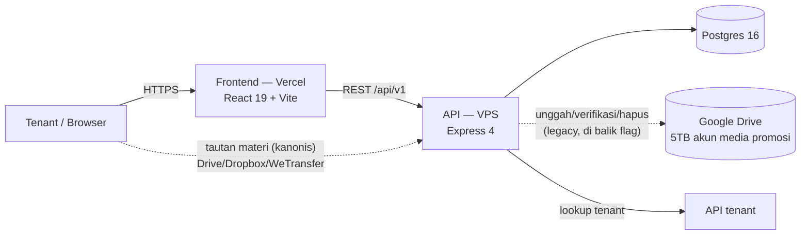

# Medprom Metmal — Platform Media Promosi Tenant

Platform pengajuan materi media promosi untuk tenant **Metropolitan Mall
Bekasi**. Tenant mengisi form pengajuan materi promosi, tim **Tenant
Relations** mengecek dan memproses materi promosinya.

Katalog media beserta ukuran, material, harga, dan ketentuannya bersumber dari
deck *"MEDIA PROMOSI METROPOLITAN MALL BEKASI 2026"* — 13 slide media. Platform
memecah satu slide social media ("Instagram, Fanpage, dan Tiktok") menjadi dua
entri (feed dan story), sehingga totalnya 14 jenis media; 13 aktif, dan
**Vertical Banner** belum tersedia (masih digunakan Mall).

## Kemampuan

### Sisi tenant — publik, tanpa login

- Katalog media per kategori Outdoor, Indoor, dan Media Sosial, memuat ukuran,
  material, harga, serta ketentuan pemasangan tiap media.
- Form pengajuan tiga tahap: pilih media, isi data tenant dan PIC, kirim
  materi.
- Nama tenant dipilih dari API tenant. Bila API tidak tersedia, form beralih ke
  isian nama manual.
- Dua cara mengirim materi:
  - **Kirim tautan** (kanonis) — Google Drive, Dropbox, atau WeTransfer untuk
    materi berukuran besar maupun folder berisi banyak file. Tidak ada file yang
    tersimpan di server. Materi diverifikasi manual oleh tim Tenant Relations.
  - **Unggah file** (legacy) — file dikirim langsung dari browser ke
    penyimpanan objek, lalu diverifikasi server. Jalur ini hanya aktif bila
    `VITE_PROMO_UPLOAD_MODE='1'`; lihat [Mode unggah legacy](#mode-unggah-legacy).
- Ketentuan lead time tiap media ditegakkan: tanggal pemasangan ditolak bila
  kurang dari ketentuan deck ("2 hari sebelum pemasangan" atau "3 hari kerja
  sebelum pemasangan"), baik di form maupun di server.
- Nomor tiket setelah pengajuan terkirim, plus halaman Riwayat yang menampilkan
  status dan catatan tim tanpa perlu akun.

### Sisi staf — perlu login

- Daftar pengajuan dengan filter status, paginasi, dan detail per pengajuan.
- Penetapan status: Menunggu, Disetujui, Ditolak, atau Terpasang, disertai
  catatan yang langsung terlihat oleh tenant.
- Pengelolaan katalog media: harga, ukuran, ketentuan, dan status aktif.
- Ekspor CSV siap dibuka di Excel.
- Pengelolaan akun staf.

### Hak akses

| Role | Lihat pengajuan | Proses & katalog | Kelola akun |
|---|---|---|---|
| `superadmin` | Ya | Ya | Ya |
| `admin` | Ya | Ya | Tidak |
| `tenant_relation` | Ya | Tidak | Tidak |

## Arsitektur



- Frontend berjalan di Vercel sebagai SPA; seluruh path di-rewrite ke
  `index.html`.
- API dan Postgres berjalan di VPS melalui Docker Compose, diproksi Caddy ke
  `127.0.0.1:3002`.
- **Kanal kanonis** adalah tautan: tenant menyimpan materinya di penyimpanan
  sendiri dan mengirim URL; tim Tenant Relations memverifikasi manual. Tidak ada
  berkas tenant yang masuk ke storage mall pada jalur ini.
- Jalur unggah (garis putus-putus) masih tersedia untuk memproses data lama dan
  penyimpanan Drive akun `mediapromosi.metmalbekasi@gmail.com` (Google One 5TB)
  tetap dipakai selama transisi. Unggahan diverifikasi di server (signature byte
  + ukuran) SEBELUM ditulis ke Drive sehingga file tidak valid tidak pernah
  memenuhi storage.
- Sesi staf memakai JWT pada cookie lintas origin (`SameSite=None; Secure`).

### Validasi pengajuan

Untuk mode unggah, server memeriksa

1. rate limit 10 pengajuan per jam per IP
2. field wajib (+ telepon, format tanggal, media aktif)
3. drive_file_id benar-benar ada di Drive (milik akun app, bukan tenant lain —
   scope OAuth `drive.file`)
4. metadata Drive: ukuran ≤ 50MB
5. file belum dipakai pengajuan lain (unique constraint DB)
6. rate limit 5 pengajuan per perangkat dalam 24 jam (fingerprint)

Mode tautan hanya menerima URL berskema `http` atau `https`.

Kedua mode memeriksa **lead time** setelah media diketahui: tanggal pemasangan
harus menyisakan cukup waktu menurut ketentuan media tersebut. Aturan diturunkan
dari teks `rules` katalog — bukan dari kategori — karena ketentuannya tidak
seragam (boom gate tergolong outdoor tetapi memakai hari kerja). Pengajuan yang
masuk lebih lambat dari lead time ditolak `400` dengan pesan yang menyebut
jumlah hari; dashboard staf menandainya sebagai berisiko.

Perhitungan hari kerja hanya mengecualikan Sabtu dan Minggu — tabel hari libur
nasional belum tersedia, sehingga tanggal pasang yang jatuh pada hari libur
nasional belum ditolak.

## Struktur

```
src/                      Frontend React (Vite + Tailwind v4)
  components/promo/       Katalog, form pengajuan, riwayat, pemilih tenant
  components/admin/       Login dan dashboard staf
  utils/                  promoApi, adminApi, fingerprint, leadTime, whatsapp
  lib/rest.ts             Klien REST
server/
  schema.sql              Skema database
  src/routes/             promo (publik), admin (staf), auth
  src/drive.js            Upload, verifikasi, delete, metadata — Google Drive REST v3
  src/lib/leadTime.js     Lead time (cermin src/utils/leadTime.ts)
  src/auth.js             JWT, bcrypt, kontrol role
  scripts/                seed-media-types, create-admin
scripts/                  db-migrate, drive-auth, drive-sweep, verifikasi produksi (Playwright)
__tests__/api/            Test route server
deploy/vps/               docker-compose, .env.example, panduan deploy
```

`src/utils/leadTime.ts` dan `server/src/lib/leadTime.js` adalah **cermin yang
disengaja** (proyek ini belum punya paket bersama). Keduanya dikunci oleh test
kontrak `__tests__/api/lead-time.test.js`, sehingga perubahannya harus selalu
berpasangan.

## Menjalankan di lokal

Prasyarat: Node 20 atau lebih baru, Postgres 16, dan akun Google
dengan akses Drive API (refresh token dari `scripts/drive-auth.mjs`) bila ingin
menguji unggahan file.

```bash
npm ci
cp .env.example .env          # isi DATABASE_URL, JWT_SECRET, GOOGLE_*
npm run db:migrate            # buat atau perbarui skema
npm run db:seed               # isi katalog media

# Akun staf pertama
ADMIN_PASSWORD='Password-Kuat' node server/scripts/create-admin.mjs \
  admin@metmal.co.id '' 'Admin Medprom'

npm run dev:api               # API      → http://localhost:3001
npm run dev                   # Frontend → http://localhost:5173
```

`db:migrate` dan `db:seed` aman dijalankan berulang. Seed menyelaraskan dua
kolom yang bersumber langsung dari deck — `accepted_formats` dan `rules` —
sehingga koreksi ketentuan ikut tersebar ke instance yang sudah jalan. Harga,
lokasi, dan kolom lain hasil penyuntingan admin tidak ditimpa.

## Perintah

| Perintah | Fungsi |
|---|---|
| `npm run dev` | Menjalankan frontend mode pengembangan |
| `npm run dev:api` | Menjalankan API dengan reload otomatis |
| `npm test` | Menjalankan test route server dan komponen |
| `npm run build` | Type check dan build produksi |
| `npm run db:migrate` | Menerapkan `server/schema.sql` |
| `npm run db:seed` | Mengisi dan menyelaraskan katalog media |

Verifikasi produksi lewat browser sungguhan, membutuhkan `VERIFY_PASSWORD`:

```bash
node scripts/verify-e2e.mjs            # katalog → form → dashboard → riwayat
node scripts/verify-tenant-upload.mjs  # unggah file nyata hingga muncul di dashboard
node scripts/verify-admin-flow.mjs     # penetapan status staf hingga terlihat tenant
```

## Format materi

Format yang diterima diatur per jenis media pada kolom `accepted_formats`, dan
dipakai baik oleh pemilih file di frontend maupun daftar izin MIME di server.

| Kelompok media | Format |
|---|---|
| Cetak: spanduk, big banner, umbul-umbul, boom gate, sticker, vertical banner | JPEG, PNG, PDF |
| LED Banner, Digital Poster | JPEG |
| Videotron, Integrasia, Media Sosial | JPEG, PNG, MP4 |

Deck hanya menetapkan format file untuk media digital (LED Banner, Digital
Poster: JPEG; Videotron/Integrasia/Media Sosial: JPEG/MP4) dan menyebut
substrat fisik untuk media cetak (Flexi, sticker vinyl) — bukan format file.
Format cetak di atas adalah kebijakan operasional platform, bukan klaim deck.

Batas unggahan 50MB. Untuk materi yang lebih besar, gunakan mode kirim tautan.
Materi media sosial juga dapat dikirim via email ke `marketing@malmetropolitan.com`
(lihat ketentuan tiap media).

## Mode unggah legacy

Kanal kanonis platform adalah **kirim tautan**; mode unggah dipertahankan hanya
untuk masa transisi dan memproses pengajuan lama. Secara default tenant melihat
antarmuka tautan saja — pengalih mode unggah dan area unggah tidak dirender.

Untuk menyalakannya (hanya bila benar-benar diperlukan):

```bash
# .env — nilai '1' mengaktifkan jalur unggah
VITE_PROMO_UPLOAD_MODE=1
```

Flag ini sengaja **tidak** dicantumkan di `.env.example` agar tidak ikut
tersalin saat deploy baru. Perlu diketahui: kode unggah tetap ikut ter-bundle
karena mode sumber adalah state React — flag hanya menggerbangi perenderan UI,
bukan menghapus kode dari bundel.

Rencana pensiun bertahap: server menolak `drive_file_id` → `POST /drive/upload`
mengembalikan `410 Gone` → arsip berkas legacy dibuat → baru kolom Drive
dihapus.

## Deploy

Langkah lengkap Docker Compose, migrasi, seed, konfigurasi Caddy, dan deploy
Vercel ada di [`deploy/vps/README-DEPLOY.md`](deploy/vps/README-DEPLOY.md).

## Lisensi

Proprietary — penggunaan internal Metropolitan Mall Bekasi.
