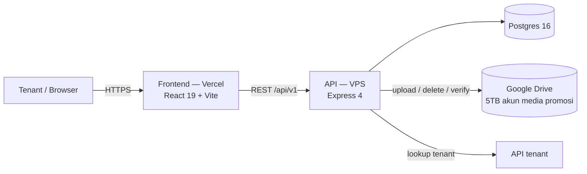

# Medprom Metmal — Platform Media Promosi Tenant

Platform pengajuan materi media promosi untuk tenant **Metropolitan Mall
Bekasi**. Tenant mengisi form pengajuan materi promosi, tim **Tenant
Relations** mengecek dan memproses materi promosinya.

Katalog media beserta ukuran, material, harga, dan ketentuannya bersumber dari
deck *"MEDIA PROMOSI METROPOLITAN MALL BEKASI 2026"*: 14 jenis media, 13 di
antaranya aktif (Parapet belum tersedia).

## Kemampuan

### Sisi tenant — publik, tanpa login

- Katalog media per kategori Outdoor, Indoor, dan Media Sosial, memuat ukuran,
  material, harga, serta ketentuan pemasangan tiap media.
- Form pengajuan tiga tahap: pilih media, isi data tenant dan PIC, kirim
  materi.
- Nama tenant dipilih dari API tenant. Bila API tidak tersedia, form beralih ke
  isian nama manual.
- Dua cara mengirim materi:
  - **Unggah file** — file dikirim langsung dari browser ke penyimpanan objek,
    lalu diverifikasi server.
  - **Kirim tautan** — Google Drive, Dropbox, atau WeTransfer untuk materi
    berukuran besar maupun folder berisi banyak file. Tidak ada file yang
    tersimpan di server.
- Nomor tiket setelah pengajuan terkirim, plus halaman Riwayat yang menampilkan
  status dan catatan tim tanpa perlu akun.

### Sisi staf — perlu login

- Daftar pengajuan dengan filter status, paginasi, dan detail per pengajuan.
- Penetapan status: Menunggu, Disetujui, Ditolak, atau Terpasang, disertai
  catatan yang langsung terlihat oleh tenant.
- Pengelolaan katalog media: harga, ukuran, ketentuan, dan status aktif.
- Ekspor CSV siap dibuka di Excel.
- Pengelolaan akun staf.

### Hak akses

| Role | Lihat pengajuan | Proses & katalog | Kelola akun |
|---|---|---|---|
| `superadmin` | Ya | Ya | Ya |
| `admin` | Ya | Ya | Tidak |
| `tenant_relation` | Ya | Tidak | Tidak |

## Arsitektur



- Frontend berjalan di Vercel sebagai SPA; seluruh path di-rewrite ke
  `index.html`.
- API dan Postgres berjalan di VPS melalui Docker Compose, diproksi Caddy ke
  `127.0.0.1:3002`.
- File materi disimpan di Google Drive akun khusus
  `mediapromosi.metmalbekasi@gmail.com` (Google One 5TB). Unggahan diverifikasi
  di server (signature byte + ukuran) SEBELUM ditulis ke Drive sehingga file
  tidak valid tidak pernah memenuhi storage.
- Sesi staf memakai JWT pada cookie lintas origin (`SameSite=None; Secure`).

### Validasi pengajuan

Untuk mode unggah, server memeriksa

1. rate limit 10 pengajuan per jam per IP
2. field wajib (+ telepon, format tanggal, media aktif)
3. drive_file_id benar-benar ada di Drive (milik akun app, bukan tenant lain —
   scope OAuth `drive.file`)
4. metadata Drive: ukuran ≤ 50MB
5. file belum dipakai pengajuan lain (unique constraint DB)
6. rate limit 5 pengajuan per perangkat dalam 24 jam (fingerprint)

Semua klaim klien (nama file, MIME, ukuran) diverifikasi ulang oleh server
dari metadata Drive. Magic bytes diverifikasi saat upload — file tidak valid
ditolak tanpa ditulis ke Drive.

Mode tautan hanya menerima URL berskema `http` atau `https`.

## Struktur

```
src/                      Frontend React (Vite + Tailwind v4)
  components/promo/       Katalog, form pengajuan, riwayat, pemilih tenant
  components/admin/       Login dan dashboard staf
  utils/                  promoApi, adminApi, fingerprint
  lib/rest.ts             Klien REST
server/
  schema.sql              Skema database
  src/routes/             promo (publik), admin (staf), auth
  src/drive.js            Upload, verifikasi, delete, metadata — Google Drive REST v3
  src/auth.js             JWT, bcrypt, kontrol role
  scripts/                seed-media-types, create-admin
scripts/                  db-migrate, drive-auth, verifikasi produksi (Playwright)
__tests__/api/            Test route server
deploy/vps/               docker-compose, .env.example, panduan deploy
```

## Menjalankan di lokal

Prasyarat: Node 20 atau lebih baru, Postgres 16, dan akun Google
dengan akses Drive API (refresh token dari `scripts/drive-auth.mjs`) bila ingin
menguji unggahan file.

```bash
npm ci
cp .env.example .env          # isi DATABASE_URL, JWT_SECRET, GOOGLE_*
npm run db:migrate            # buat atau perbarui skema
npm run db:seed               # isi katalog media

# Akun staf pertama
ADMIN_PASSWORD='Password-Kuat' node server/scripts/create-admin.mjs \
  admin@metmal.co.id '' 'Admin Medprom'

npm run dev:api               # API      → http://localhost:3001
npm run dev                   # Frontend → http://localhost:5173
```

`db:migrate` dan `db:seed` aman dijalankan berulang. Seed hanya menyelaraskan
daftar format yang diterima; harga dan ketentuan hasil penyuntingan admin tidak
ditimpa.

## Perintah

| Perintah | Fungsi |
|---|---|
| `npm run dev` | Menjalankan frontend mode pengembangan |
| `npm run dev:api` | Menjalankan API dengan reload otomatis |
| `npm test` | Menjalankan test route server dan komponen |
| `npm run build` | Type check dan build produksi |
| `npm run db:migrate` | Menerapkan `server/schema.sql` |
| `npm run db:seed` | Mengisi dan menyelaraskan katalog media |

Verifikasi produksi lewat browser sungguhan, membutuhkan `VERIFY_PASSWORD`:

```bash
node scripts/verify-e2e.mjs            # katalog → form → dashboard → riwayat
node scripts/verify-tenant-upload.mjs  # unggah file nyata hingga muncul di dashboard
node scripts/verify-admin-flow.mjs     # penetapan status staf hingga terlihat tenant
```

## Format materi

Format yang diterima diatur per jenis media pada kolom `accepted_formats`, dan
dipakai baik oleh pemilih file di frontend maupun daftar izin MIME di server.

| Kelompok media | Format |
|---|---|
| Cetak: spanduk, big banner, umbul-umbul, boom gate, sticker, vertical banner | JPEG, PNG, PDF |
| LED Banner, Digital Poster | JPEG, PNG |
| Videotron, Integrasia, Media Sosial | JPEG, PNG, MP4 |

Batas unggahan 50MB. Untuk materi yang lebih besar, gunakan mode kirim tautan.

## Deploy

Langkah lengkap Docker Compose, migrasi, seed, konfigurasi Caddy, dan deploy
Vercel ada di [`deploy/vps/README-DEPLOY.md`](deploy/vps/README-DEPLOY.md).

## Lisensi

Proprietary — penggunaan internal Metropolitan Mall Bekasi.
